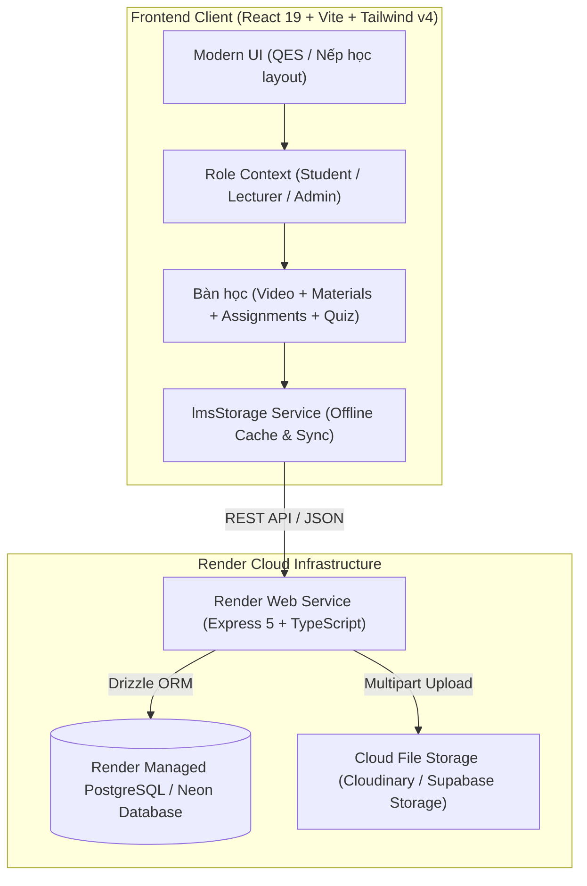

# BOOM_LMS (Nếp Học) - Tài Liệu Đặc Tả Kiến Trúc & Tính Năng Cốt Lõi (Core Spec)

> **Mục tiêu dự án:** Xây dựng một hệ thống Quản lý Học tập Trực tuyến (LMS) hiện đại, tinh giản tối đa theo các tính năng cốt lõi (Core Prerequisites) của Moodle, loại bỏ 95% sự cồng kềnh không cần thiết. Hệ thống gồm **React Frontend** chuẩn giao diện hiện đại và **Node.js Express Backend** tối ưu hóa sẵn sàng deploy lên nền tảng đám mây **Render.com**.

---

## 1. Tổng quan Kiến trúc Toàn hệ thống (System Architecture)



---

## 2. Phần Giao Diện (Frontend - `client`)

### 2.1. Công nghệ sử dụng
- **Core:** React 19, TypeScript, Vite 6.
- **Styling:** Tailwind CSS v4, Lucide Icons, Radix UI Primitives (Accordion, Dialog, Tabs, Tooltip, Dropdown).
- **Routing & State:** Wouter (Single-Page Routing siêu nhẹ), TanStack Query v5.
- **Thiết kế:** Docked Left Sidebar, Top Navigation Bar kèm Fast Role Switcher.

### 2.2. Ánh xạ Tính năng Cốt lõi của Moodle (Moodle Core Prerequisites)

| Tính năng cốt lõi Moodle | Triển khai trên Frontend | Đường dẫn file / Component |
| :--- | :--- | :--- |
| **1. Quản lý tài khoản & Phân quyền** | 3 vai trò: Học viên (`student`), Giảng viên (`lecturer`), Quản trị (`admin`). Hỗ trợ Role Switcher chuyển vai trò nhanh trên thanh điều hướng. | [RoleContext.tsx](file:///e:/Wamp/lms/client/src/contexts/RoleContext.tsx)<br/>[AppShell.tsx](file:///e:/Wamp/lms/client/src/components/layout/AppShell.tsx) |
| **2. Danh mục Khóa học (Courses)** | Danh sách môn học dạng lưới, tìm kiếm theo tên/chủ đề, tiến độ hoàn thành, liên kết trực tiếp vào bàn học theo ID môn (`?courseId=...`). | [Courses.tsx](file:///e:/Wamp/lms/client/src/pages/Courses.tsx)<br/>[CourseDialog.tsx](file:///e:/Wamp/lms/client/src/components/dialogs/CourseDialog.tsx) |
| **3. Đăng tài liệu học phần (Materials)** | Bộ lọc theo Slide PPT, PDF, Văn bản Word, Video. Giảng viên có modal đăng tài liệu; Học viên có nút xem & tải về kèm đếm lượt tải. | [MaterialsTab.tsx](file:///e:/Wamp/lms/client/src/components/learning/MaterialsTab.tsx)<br/>[CreateMaterialDialog.tsx](file:///e:/Wamp/lms/client/src/components/dialogs/CreateMaterialDialog.tsx) |
| **4. Giao bài & Nộp bài tập (Assignments)** | - Giảng viên: Giao bài (hạn nộp, thang điểm, đề bài) và xem danh sách bài nộp, chấm điểm, ghi nhận xét.<br/>- Học viên: Xem deadline, kéo thả nộp file, xem điểm và lời phê. | [AssignmentsTab.tsx](file:///e:/Wamp/lms/client/src/components/learning/AssignmentsTab.tsx)<br/>[CreateAssignmentDialog.tsx](file:///e:/Wamp/lms/client/src/components/dialogs/CreateAssignmentDialog.tsx)<br/>[SubmitAssignmentDialog.tsx](file:///e:/Wamp/lms/client/src/components/dialogs/SubmitAssignmentDialog.tsx)<br/>[GradeSubmissionDialog.tsx](file:///e:/Wamp/lms/client/src/components/dialogs/GradeSubmissionDialog.tsx) |
| **5. Không gian học tập (Classroom)** | Bàn học trực tuyến 4 Tab: Bài giảng Video/Audio, Tài liệu học phần, Bài tập & Nộp bài, Trắc nghiệm Quiz Game. | [LearningPortal.tsx](file:///e:/Wamp/lms/client/src/pages/LearningPortal.tsx) |

---

## 3. Phần Máy Chủ (Backend - `server`)

### 3.1. Công nghệ sử dụng
- **Runtime:** Node.js 20+ / Express 5, TypeScript.
- **Cơ sở dữ liệu & ORM:** Drizzle ORM (Zero-overhead, type-safe).
  - *Môi trường phát triển cục bộ (Local):* SQLite (`lms.db`).
  - *Môi trường đám mây (Render Production):* Render Managed PostgreSQL / Neon Database.
- **Bảo mật & Phiên:** JWT (JSON Web Tokens), bcrypt hashing mật khẩu, CORS whitelist.

### 3.2. Cấu trúc Cơ sở Dữ liệu Tối giản (6 Bảng Cốt lõi)

```sql
-- 1. Người dùng & Phân quyền
CREATE TABLE users (
  id SERIAL PRIMARY KEY,
  name VARCHAR(255) NOT NULL,
  email VARCHAR(255) UNIQUE NOT NULL,
  password_hash VARCHAR(255) NOT NULL,
  role VARCHAR(50) NOT NULL DEFAULT 'student', -- 'student', 'lecturer', 'admin'
  team VARCHAR(100) DEFAULT 'Lớp 10A',
  avatar VARCHAR(10) DEFAULT 'US',
  created_at TIMESTAMP DEFAULT CURRENT_TIMESTAMP
);

-- 2. Khóa học / Môn học
CREATE TABLE courses (
  id SERIAL PRIMARY KEY,
  title VARCHAR(255) NOT NULL,
  description TEXT,
  category VARCHAR(100) DEFAULT 'Chuyên môn',
  level VARCHAR(50) DEFAULT 'Cơ bản',
  duration VARCHAR(50) DEFAULT '2 giờ',
  lessons INT DEFAULT 4,
  thumbnail VARCHAR(500),
  teacher_id INT REFERENCES users(id),
  created_at TIMESTAMP DEFAULT CURRENT_TIMESTAMP
);

-- 3. Ghi danh lớp học (Enrollments)
CREATE TABLE enrollments (
  id SERIAL PRIMARY KEY,
  user_id INT REFERENCES users(id) ON DELETE CASCADE,
  course_id INT REFERENCES courses(id) ON DELETE CASCADE,
  enrolled_at TIMESTAMP DEFAULT CURRENT_TIMESTAMP,
  UNIQUE(user_id, course_id)
);

-- 4. Học liệu / Tài liệu môn học (Materials)
CREATE TABLE materials (
  id SERIAL PRIMARY KEY,
  course_id INT REFERENCES courses(id) ON DELETE CASCADE,
  lesson_number INT DEFAULT 1,
  title VARCHAR(255) NOT NULL,
  type VARCHAR(50) NOT NULL, -- 'pdf', 'slide', 'doc', 'video', 'link'
  file_url VARCHAR(500) NOT NULL,
  file_name VARCHAR(255),
  file_size VARCHAR(50),
  description TEXT,
  uploaded_by VARCHAR(255),
  download_count INT DEFAULT 0,
  created_at TIMESTAMP DEFAULT CURRENT_TIMESTAMP
);

-- 5. Bài tập được giao (Assignments)
CREATE TABLE assignments (
  id SERIAL PRIMARY KEY,
  course_id INT REFERENCES courses(id) ON DELETE CASCADE,
  title VARCHAR(255) NOT NULL,
  description TEXT,
  due_date DATE NOT NULL,
  max_points NUMERIC(5,2) DEFAULT 10.00,
  attachment_url VARCHAR(500),
  attachment_name VARCHAR(255),
  created_by VARCHAR(255),
  created_at TIMESTAMP DEFAULT CURRENT_TIMESTAMP
);

-- 6. Bài nộp của học viên (Submissions)
CREATE TABLE submissions (
  id SERIAL PRIMARY KEY,
  assignment_id INT REFERENCES assignments(id) ON DELETE CASCADE,
  student_id INT REFERENCES users(id) ON DELETE CASCADE,
  file_url VARCHAR(500),
  file_name VARCHAR(255),
  file_size VARCHAR(50),
  text_content TEXT,
  status VARCHAR(50) DEFAULT 'submitted', -- 'submitted', 'graded'
  grade NUMERIC(5,2),
  feedback TEXT,
  graded_by VARCHAR(255),
  graded_at TIMESTAMP,
  submitted_at TIMESTAMP DEFAULT CURRENT_TIMESTAMP,
  UNIQUE(assignment_id, student_id)
);
```

### 3.3. Danh sách Endpoint REST API cốt lõi

```
POST   /api/auth/register            -> Đăng ký tài khoản mới
POST   /api/auth/login               -> Đăng nhập, trả về JWT token
GET    /api/auth/me                  -> Lấy thông tin tài khoản hiện tại từ token

GET    /api/courses                  -> Danh sách môn học
POST   /api/courses                  -> Tạo môn học mới (Admin/Giảng viên)
GET    /api/courses/:id              -> Chi tiết môn học

GET    /api/courses/:id/materials    -> Lấy danh sách tài liệu theo môn học
POST   /api/courses/:id/materials    -> Giảng viên đăng tài liệu mới
DELETE /api/materials/:id            -> Xóa tài liệu

GET    /api/courses/:id/assignments  -> Danh sách bài tập của môn học
POST   /api/courses/:id/assignments  -> Giảng viên giao bài tập mới

POST   /api/assignments/:id/submit   -> Học viên nộp bài làm
GET    /api/assignments/:id/subs     -> Giảng viên xem danh sách bài nộp của lớp
PATCH  /api/submissions/:id/grade    -> Giảng viên chấm điểm và nhập lời nhận xét

POST   /api/upload                   -> Upload file tài liệu / bài làm lên Cloud Storage
```

---

## 4. Hướng Dẫn Triển Khai Lên Render (Render Deployment Guide)

### 4.1. Khắc phục hạn chế của Render Free Tier
1. **Ephemeral Disk (Ổ đĩa tạm):**
   - Không lưu file upload vào thư mục local trên Render.
   - Sử dụng **Supabase Storage** (5GB miễn phí) hoặc **Cloudinary** (25GB miễn phí) để lưu trữ tệp tài liệu và bài nộp của học viên.
2. **Cơ sở dữ liệu:**
   - Tạo một **Free PostgreSQL Instance** trên Render Dashboard (hoặc kết nối Neon/Supabase).
   - Truyền biến môi trường `DATABASE_URL=postgres://...` vào Render Web Service.

### 4.2. Cấu hình Render Web Service
- **Build Command:** `pnpm install && pnpm --filter server build`
- **Start Command:** `pnpm --filter server start`
- **Environment Variables:**
  - `PORT`: `5000` (Render tự động cấp hoặc gán)
  - `NODE_ENV`: `production`
  - `DATABASE_URL`: Đường dẫn kết nối PostgreSQL
  - `JWT_SECRET`: Khóa bí mật ký mã xác thực
  - `CLIENT_URL`: URL frontend (Vercel hoặc Render Static Site) để cấu hình CORS.
